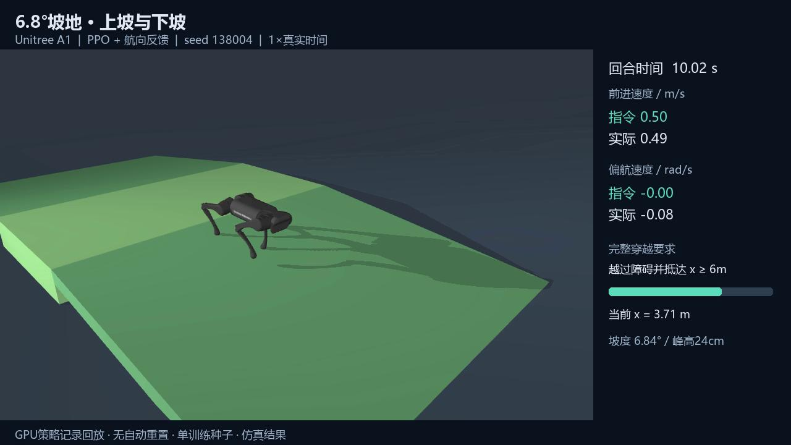

# 四足机器人强化学习控制与运动自适应

基于 Unitree A1 仿真模型，研究 **PPO 控制、RMA 历史适应、GPU 并行训练与地形迁移评估**。先独立实现 CPU 上的 PPO/RMA 核心链路，再借鉴 MuJoCo Playground / Brax 扩展 GPU 任务，使用固定对照和失败回合检验结果。

**[▶ 在线演示](https://yeezhouyi.github.io/a1-rl-locomotion/) · [下载90秒视频](https://github.com/yeezhouyi/a1-rl-locomotion/releases/download/v1.0-demo/A1_terrain_demo.mp4) · [模型与证据](https://github.com/yeezhouyi/a1-rl-locomotion/releases/tag/v1.0-demo)**



视频包括六级 **3.5cm 台阶**、**6.84° 上下坡**、变速停走与转向。四段任务各保留完整20秒、原速回放，画面显示指令/实际速度。控制方式为 **PPO 速度策略＋高层航向反馈**；这是仿真验证，没有真机部署。

## 项目贡献

| 部分 | 实现与复用边界 |
|---|---|
| CPU PPO / RMA | 独立实现PPO/GAE、特权教师、历史适应器、域随机化及固定/零隐变量、打乱历史对照 |
| GPU PPO | 复用Brax PPO和Playground任务，适配A1传感器、PD控制、碰撞、资产与独立评估 |
| 诊断与任务扩展 | 原地站立诊断、奖励配置探索、地形空间覆盖、约束容量及检查点恢复故障修复 |
| 地形与演示 | 本地真实box台阶/坡面；参考legged_gym航向指令反馈；完整穿越验收、逐步轨迹与视频 |

GPU actor为48维，含局部线速度；critic为123维特权观测。GPU路线**没有RMA历史适应器**，与CPU的45维盲行策略不可直接归因比较。源码归属及许可证见[第三方声明](THIRD_PARTY_NOTICES.md)和[来源说明](docs/gpu_sources.md)。

## 实测结果

| 实验 | 结果 | 解释 |
|---|---|---|
| RTX 4060 Laptop同步仿真探针 | 1,024并行，约31,585控制步/秒 | 仅物理rollout吞吐，不是PPO完整训练速度 |
| 平地指令固定保留集 | 8/8达标，0跌倒 | 单训练seed，每类2回合 |
| 新粗糙空间保留集 | 直接迁移1/8 → 追加训练7/8 | 仍1次跌倒；额外预算/分布变化，不是等预算消融 |
| 低台阶/缓坡＋航向反馈保留集 | 旧模型8/8，专门续训8/8 | 不能声称续训提高通过率 |
| 专门地形续训、纯yaw-rate开发集 | 4/8，无跌倒、4次偏离通道 | 高层反馈是完整展示的组成 |
| CPU RMA多种子确认 | 3种子×7方法×11场景，共1,155回合 | 种子差异大，未证明适应器稳定优于基线 |
| 传感器/优化压力测试 | 432回合 | 保留无收益与40ms观测延迟失败边界 |

地形任务达标要求完整20秒、无跌倒/越界、最终x≥6m、平面速度向量RMSE<0.2m/s、yawRMSE<0.3rad/s。视频按每场景首个达标回合选取，不代表公开了所有评估视频；全部8回合指标在[evidence](evidence/README.md)，两组轨迹在Release。

[坡地台阶结果](docs/gpu_course_results.md) · [GPU结果与故障分析](docs/gpu_results.md) · [CPU多种子结果](docs/third_results.md) · [传感器压力测试](docs/fourth_results.md)

## 快速开始：CPU核心实现

Python 3.12，建议独立虚拟环境。GPU不是运行CPU链路的前提。

```bash
git clone https://github.com/yeezhouyi/a1-rl-locomotion.git
cd a1-rl-locomotion
python -m venv .venv
# Linux/macOS: source .venv/bin/activate
# Windows PowerShell: .venv/Scripts/Activate.ps1
python -m pip install -e '.[test]'
python tools/fetch_assets.py
python -m pytest -q
python tools/run_experiment.py --out outputs/smoke_demo --ppo-iterations 2 --adapt-iterations 2 --episodes 1
```

最后一条是链路试跑，不保证学会行走。`fetch_assets.py`按`assets-lock.json`核验A1资产、保留其BSD许可证。需要CPU版Torch时可先从PyTorch CPU索引安装；本仓库不附CUDA依赖缓存。

## GPU复跑：已有检查点

实测环境为Linux / WSL Ubuntu24.04、RTX4060 Laptop 8GiB、Python3.12，JAX0.8.2、MuJoCo/MJX/mujoco-warp3.15.0、Brax0.14.2、Warp1.18.0。Windows CPU与Linux GPU使用**不同虚拟环境**。驱动和CUDA能力必须匹配，初次依赖下载与编译不包含在训练内部计时中。

1. 在Linux或WSL中，把整个项目放在有足够空间的磁盘；脚本不修改已有WSL环境、不创建磁盘镜像。
2. 准备单独GPU环境和固定上游快照：

```bash
bash tools/setup_gpu_public.sh
source .venv-gpu/bin/activate
python -c "import jax; print(jax.default_backend(), jax.devices()); assert jax.default_backend() == 'gpu'"
```

3. 使用CPU虚拟环境执行资产获取/生成（此前已安装MuJoCo3.3.5）：

```bash
.venv/bin/python tools/fetch_assets.py
.venv/bin/python tools/build_gpu_a1_assets.py --out outputs/gpu_assets
.venv/bin/python tools/build_gpu_course.py --source outputs/gpu_assets --out outputs/course_assets
```

4. 从Release下载并解压`A1_course_checkpoint.zip`至`outputs/model`，其内部有`checkpoint/`。GPU评估：

```bash
XLA_PYTHON_CLIENT_PREALLOCATE=false MUJOCO_GL=egl python tools/evaluate_gpu_course.py \
  --assets outputs/course_assets --checkpoint outputs/model/checkpoint \
  --out outputs/course_eval --protocol holdout --heading-feedback
```

输出8回合`evaluation.json`与`trajectories.npz`；目录须不存在，避免覆盖。去掉`--heading-feedback`是不同控制条件。GPU浮点/依赖平台差异可能使轨迹变化，不承诺逐位相同或任何机器都8/8。没有GPU时可查看公开指标与预录视频。

## 训练入口

```bash
# GPU平地从随机参数训练；约30M控制样本，不能预承诺收敛。
XLA_PYTHON_CLIENT_PREALLOCATE=false MUJOCO_GL=egl python tools/train_gpu_a1.py \
  --assets outputs/gpu_assets --out outputs/flat_train --terrain flat \
  --batch 1024 --minibatch-size 128 --steps 30000000 --reward-profile locomotion_v2

# 从Release模型继续专门地形训练；恢复参数/normalizer，但Adam重启。
XLA_PYTHON_CLIENT_PREALLOCATE=false MUJOCO_GL=egl python tools/train_gpu_a1.py \
  --assets outputs/course_assets --out outputs/course_train --terrain course \
  --batch 512 --minibatch-size 64 --steps 30000000 --reward-profile locomotion_v2 \
  --restore outputs/model/checkpoint
```

公开检查点已接受专门训练，上述继续训练不是本轮完整训练历史的等价复跑。本轮从粗糙最终模型续训的实际配置保存在[evidence/course_train30m_s0_v3](evidence/course_train30m_s0_v3)。

## 代码导航与许可

- [`src/rma_local`](src/rma_local)：CPU PPO、RMA、训练与评估。
- [`tools/gpu_a1_env.py`](tools/gpu_a1_env.py)、[`gpu_course_env.py`](tools/gpu_course_env.py)：GPU任务适配。
- [`train_gpu_a1.py`](tools/train_gpu_a1.py)、[`evaluate_gpu_course.py`](tools/evaluate_gpu_course.py)：训练和完整穿越评估。
- [`gpu_checkpoint.py`](tools/gpu_checkpoint.py)：Brax nullable initializer恢复兼容修复。
- [`tests`](tests)：GAE终止/timeout、历史状态、随机化及地形契约。
- [`evidence`](evidence)：公开测量记录；个人绝对路径替换为占位符，指标未改写。

本仓库为从本地开发项目整理的公开快照，不包含私有机器路径、完整缓存或原本地Git历史。原始研究记录中的`<GPU_WORKSPACE>`等为去标识化占位符；按上面的公开入口复跑，无需创建同名目录。历史报告中的未发布产物以文字说明保留。

原创部分按[MIT](LICENSE)发布；上游改写保留其独立许可证和版权。机器人资产从MuJoCo Menagerie获取，Playground和legged_gym的许可见[licenses](licenses)。单训练seed、小规模仿真结果不代表跨seed稳定性、自主导航、真机部署或完整论文复现。
